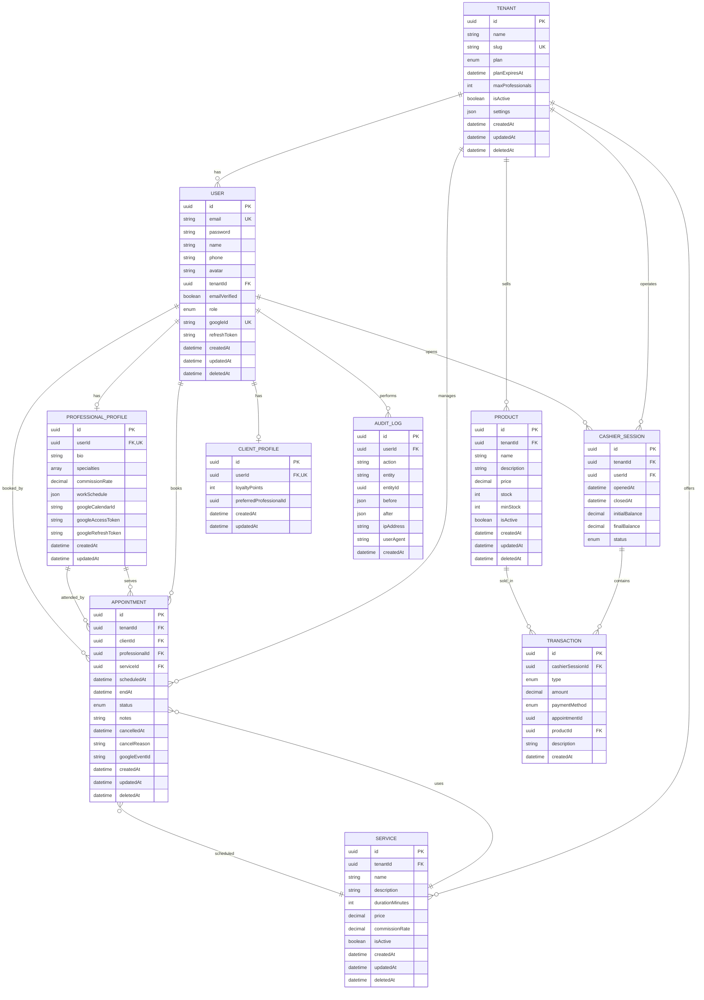

# Diagrama Entidade-Relacionamento

## Relacionamentos Principais



## Enums

### PlanType
- `FREE`: Plano gratuito (1 profissional, limitações)
- `PRO`: Plano profissional (5 profissionais)
- `PREMIUM`: Plano premium (profissionais ilimitados + features avançadas)

### UserRole
- `ADMIN`: Dono da barbearia (acesso total)
- `PROFESSIONAL`: Barbeiro (acesso aos seus agendamentos)
- `CLIENT`: Cliente (acesso aos seus agendamentos)

### AppointmentStatus
- `PENDING`: Aguardando confirmação
- `CONFIRMED`: Confirmado
- `CANCELLED`: Cancelado
- `COMPLETED`: Concluído
- `NO_SHOW`: Cliente não compareceu

### CashierStatus
- `OPEN`: Caixa aberto
- `CLOSED`: Caixa fechado

### TransactionType
- `INCOME`: Entrada (venda de serviço/produto)
- `EXPENSE`: Saída (despesa)
- `WITHDRAWAL`: Sangria

### PaymentMethod
- `CASH`: Dinheiro
- `PIX`: PIX
- `CREDIT_CARD`: Cartão de crédito
- `DEBIT_CARD`: Cartão de débito

## Indexes

### Performance Optimization

```sql
-- Tenant lookup
CREATE INDEX idx_tenants_slug ON tenants(slug);

-- User authentication
CREATE INDEX idx_users_email_tenant ON users(email, tenantId);
CREATE INDEX idx_users_google_id ON users(googleId);

-- Appointments by tenant and date
CREATE INDEX idx_appointments_tenant_date ON appointments(tenantId, scheduledAt);
CREATE INDEX idx_appointments_professional_date ON appointments(professionalId, scheduledAt);

-- Services by tenant
CREATE INDEX idx_services_tenant ON services(tenantId);

-- Products by tenant
CREATE INDEX idx_products_tenant ON products(tenantId);

-- Cashier sessions by tenant
CREATE INDEX idx_cashier_sessions_tenant_date ON cashier_sessions(tenantId, openedAt);

-- Transactions by session
CREATE INDEX idx_transactions_session_date ON transactions(cashierSessionId, createdAt);

-- Audit logs
CREATE INDEX idx_audit_logs_user_date ON audit_logs(userId, createdAt);
CREATE INDEX idx_audit_logs_entity ON audit_logs(entity, entityId);
```

## Constraints

### Unique Constraints
- `tenants.slug`: Cada barbearia tem slug único
- `users.email`: E-mail único globalmente
- `users.googleId`: Google ID único
- `professionalProfiles.userId`: Um usuário = um perfil profissional
- `clientProfiles.userId`: Um usuário = um perfil de cliente

### Foreign Keys
- Todas relações têm FK constraints
- `ON DELETE CASCADE` para perfis (quando user deletado)
- `ON DELETE RESTRICT` para relações críticas (ex: tenant em users)

## Soft Delete

Todas as entidades principais têm `deletedAt`:
- `tenants`
- `users`
- `services`
- `appointments`
- `products`

Dados nunca são permanentemente deletados, apenas marcados como deletados.
